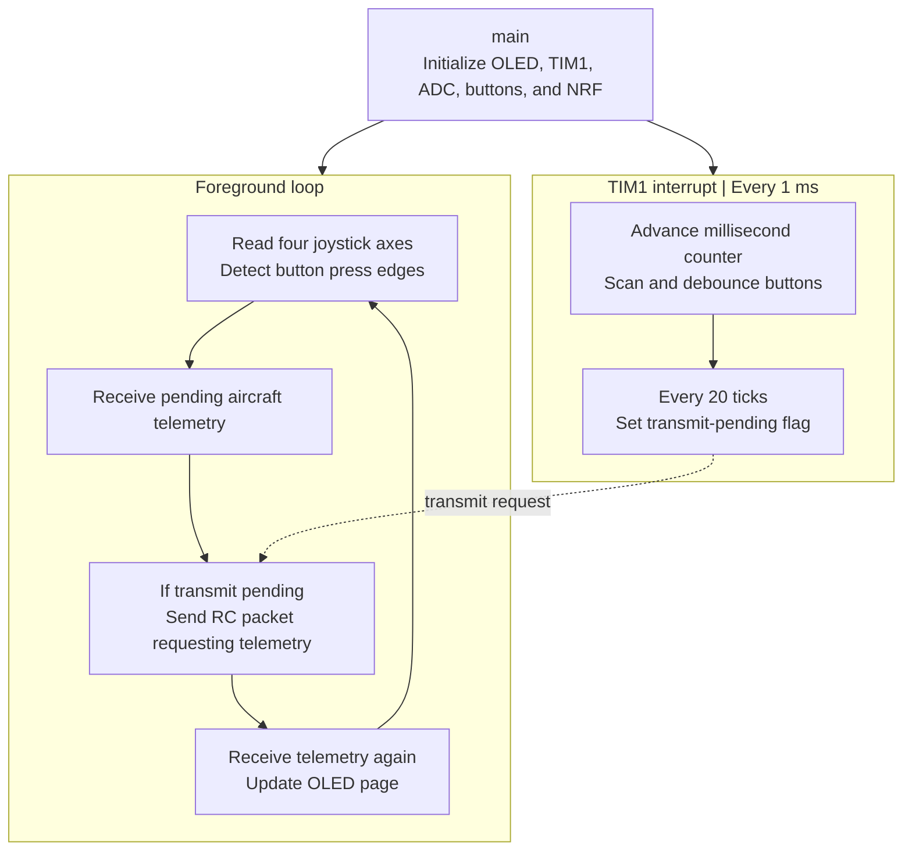

# Quadrotor RC Handheld Controller

STM32F103C8T6 handheld firmware for a quadrotor flight controller, built with **C, STM32 Standard Peripheral Library, ARM GCC, and CMake**. The controller reads four joystick axes, handles debounced buttons, sends RC commands through NRF24L01, and displays aircraft telemetry on a 128 × 64 OLED.

## Features

- Four ADC joystick inputs mapped to signed -100 to 100 commands.
- A 1 ms TIM1 interrupt provides button scanning and a 20 ms transmit schedule (nominal 50 Hz).
- NRF24L01 bidirectional communication at 2 Mbps using fixed 32-byte packets.
- K1-K4 flight commands, with STOP prioritized over other pending commands.
- Two OLED pages for joystick/command status and aircraft flight state.
- Battery and undervoltage display, send-error feedback, and a 3 s telemetry timeout indication.

## Execution flow

This firmware uses a foreground loop plus a timer interrupt; it does not use FreeRTOS.



## Controls

| Input | Function |
| --- | --- |
| LH | Yaw command |
| LV | Manual collective throttle in stabilization; vertical-speed command in altitude mode |
| RH | Roll target |
| RV | Pitch target |
| K1 | READY: stop motors and prepare aircraft control |
| K2 | STOP: prioritize the stop command and request immediate foreground transmission |
| K3 | Select stabilization mode |
| K4 | Select altitude-hold mode |
| K9 | Switch OLED page |

K5-K8 and K10-K12 have no flight-command assignment. After READY, LV above 10 triggers aircraft control start. Button scanning uses 20 ms debounce and foreground edge detection. A pending command is cleared after a successful radio ACK.

### Joystick processing

ADC1 samples PA0-PA3 sequentially. Each channel uses a first-order low-pass filter with coefficient **0.3**. `DataProcess()` subtracts the ADC center (**2048**), applies a **±100-count deadband**, and scales the remainder to approximately **-100 to 100**.

### OLED pages

- **Joystick page:** aircraft voltage/undervoltage, most recent local command, and four stick values.
- **Flight page:** aircraft voltage/undervoltage, mode, run state, throttle, roll/pitch, height, and yaw.
- `NO TELEMETRY` appears before the first valid reply or after **3 s** without a valid reply.
- `Send Error` shows the NRF transmit result when a transmission fails.

The `CMD` label identifies the most recent local key command; the aircraft's returned run state identifies its flight state. Telemetry reception and requests continue regardless of which display page is selected.

## Hardware connections

| Function | MCU pins |
| --- | --- |
| Joystick LH / LV / RH / RV | PA0 / PA1 / PA2 / PA3, ADC channels 0-3 |
| OLED software I²C | PB8 SCL, PB9 SDA |
| NRF24L01 | PB11 CE, PB12 CSN, PB13 SCK, PB14 MISO, PB15 MOSI |
| K1 / K2 / K3 / K4 | PA6 / PA7 / PB0 / PB1 |
| K9 | PB5 |
| Remaining buttons | Defined in `BSP/bsp_button/Button.c` |
| Debug | SWD |

The controller uses an **8 MHz HSE / 72 MHz system clock**. TIM1 is configured with prescaler 72 and period 1000, producing the 1 ms interrupt. NRF24L01 requires a suitable 3.3 V supply and common ground.

## Radio protocol

| Parameter | Value |
| --- | --- |
| Channel | 2 (2402 MHz) |
| Data rate | 2 Mbps |
| TX/RX address | `11 22 33 44 55` |
| Payload | 32 bytes |
| Outgoing ID | `0x11`, RC command plus telemetry request |
| Incoming ID | `0x12`, aircraft telemetry |

See [`docs/radio-protocol.md`](docs/radio-protocol.md) for the complete packet layout, numeric representation, and aircraft control mapping. The matching aircraft firmware is the **Quadrotor Flight Controller** project.

## Build

Windows build dependencies: CMake 3.15.3+, Ninja, and Arm GNU Toolchain.

```powershell
cmake -S . -B build -G Ninja -DARM_TOOLCHAIN_DIR="D:/Embedded_Toolchain/Arm-GNU-Toolchain/bin"
cmake --build build
```

Set `ARM_TOOLCHAIN_DIR` to your own compiler `bin` directory. It is a cache option in `arm-none-eabi-gcc.cmake`. Use a fresh build directory when switching compilers. The build uses `-O0 -g3` and enables floating-point formatting for the OLED.

Outputs in `build/`: `Drone_Controller.elf`, `.hex`, `.bin`, `.s19`, and the linker map. The linker targets **64 KB Flash / 20 KB RAM**.

With ST-Link and OpenOCD:

```powershell
openocd -f interface/stlink.cfg -f target/stm32f1x.cfg -c "program build/Drone_Controller.elf verify reset exit"
```

## Source layout

```text
app/         Main loop, control packet packing, telemetry parsing, display pages
BSP/         Timer, ADC, button scanning and debounce
drivers/    Joystick processing, NRF24L01, OLED and fonts
Firmware/    CMSIS, startup code, STM32 standard peripheral library
docs/       Shared radio protocol documentation
```

See [third-party notices](THIRD_PARTY_NOTICES.md) for dependency attribution. Generated firmware, local editor settings, and backup archives are excluded through `.gitignore`.
