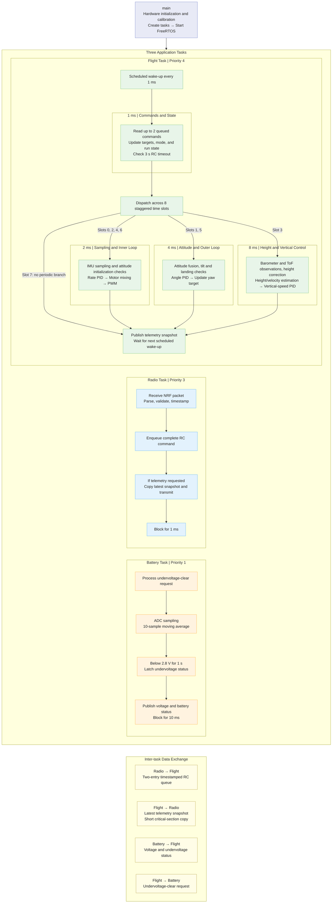

# Quadrotor Flight Controller

Embedded quadrotor flight firmware built with **STM32F103C8T6, C, FreeRTOS, ARM GCC, and CMake**.

The system combines wireless RC, attitude stabilization, altitude hold, bidirectional telemetry, and fault handling on a **72 MHz Cortex-M3**. It integrates a **QMI8658 IMU**, **SPA06 barometer**, and **VL53L1X ToF sensor**. Flight testing achieved **altitude variation within ±3 cm during altitude hold**.

## Highlights

- Three FreeRTOS application tasks separate flight control, radio communication, and battery monitoring.
- A 1 kHz system tick supports staggered 500 Hz rate control, 250 Hz attitude estimation / angle control, and 125 Hz vertical estimation / control.
- Tilt-compensated ToF measurements slowly correct barometric height drift; a third-order complementary estimator combines corrected height with gravity-compensated vertical acceleration.
- Cascaded angle/rate PID control and four-motor mixing drive four **20 kHz PWM outputs**.
- Timestamped commands use a two-entry queue; telemetry uses a single shared snapshot protected by short critical sections.
- Link-loss handling, undervoltage detection, tilt shutdown, and FreeRTOS fault records are integrated into the control flow.

## Architecture



The diagram source is also available in [`docs/architecture.mmd`](docs/architecture.mmd).

### Task scheduling

| Task | Priority | Stack | Execution pattern | Responsibility |
| --- | --- | --- | --- | --- |
| Flight | 4 | 1024 words / 4096 B | `vTaskDelayUntil`, nominal 1 ms period | Apply commands, check link timeout, run control branches, publish telemetry |
| Radio | 3 | 256 words / 1024 B | Receive/transmit work, then block 1 ms | NRF receive/validation, command submission, telemetry transmission |
| Battery | 1 | 128 words / 512 B | Sample/process, then block 10 ms | Voltage filtering, undervoltage timing/latch, clear requests |
| Idle | 0 | 128 words / 512 B | Kernel scheduled | FreeRTOS idle work |

The flight task advances an eight-slot counter. Rate control runs in slots 0/2/4/6, attitude control in slots 1/5, and height processing in slot 3. Slot 7 has no periodic control branch; command processing and snapshot publication still run. These are ordinary functions within one flight task, not additional RTOS tasks. Radio and battery delays are added after their processing time.

### Data ownership

The flight task owns flight mode, run state, targets, estimator states, PID states, and normal motor output. The radio task owns runtime NRF transfers. The battery task owns ADC sampling and battery-monitor timing.

- **RC commands:** `RemoteData_t` carries joystick values, key code, and reception tick. The flight task takes up to two entries without waiting each cycle. Commands older than 3 s are discarded, except STOP. A full queue blocks the radio producer rather than overwriting a queued key command.
- **Telemetry:** flight state is assembled outside the critical section, then copied into one shared snapshot. The radio task copies that snapshot into local storage before packing and transmitting it.
- **Battery state:** voltage, undervoltage status, and clear requests are exchanged through short critical sections. ADC sampling, computation, and radio transmission remain outside them.

## Altitude-hold design

1. **Barometric observation:** SPA06 pressure is converted to altitude and referenced to a flight zero point. Pressure and temperature are configured at 32 Hz, with 16x pressure oversampling.
2. **ToF tilt compensation:** laser slant range is projected onto the vertical axis using `distance × cos(roll) × cos(pitch)`. The ToF timing budget and measurement interval are both configured to 100 ms.
3. **Slow drift correction:** new valid laser frames correct barometric height bias through a first-order low-pass update, `alpha = dt / (dt + 10 s)`. Correction uses actual valid-frame intervals, a 4 cm barometric-height entry threshold, a 100 ms barometric age limit, and a 300 ms correction continuity limit. The laser reference includes a 1 cm installation-height adjustment.
4. **Vertical estimation:** body-frame acceleration is projected vertically, gravity is removed, and the result is converted to cm/s². A third-order complementary estimator runs every 8 ms, updating acceleration correction, vertical velocity, and height. Height innovation is limited to ±10 cm per update.
5. **Control:** a 125 Hz vertical-speed PID generates collective throttle. Centering LV commands zero vertical speed; this is velocity-based altitude hold, rather than a separate target-height position PID.

**Flight result:** altitude variation remained within **±3 cm** during altitude-hold flight testing.

## Attitude and motor control

- Startup calibration averages 1000 accelerometer samples and 1000 gyroscope samples, with 2 ms blocking waits between samples.
- The IMU layer compensates offsets and converts sensor axes into the aircraft control frame.
- Six-axis quaternion fusion updates attitude every 4 ms; angle PID outputs become rate targets for the 2 ms inner loop.
- Yaw error handles the ±180-degree boundary; roll/pitch feed-forward is added before motor mixing.
- TIM2 drives PA0-PA3: `72 MHz / 36 / 100 = 20 kHz`, with 1% duty-cycle steps. Each mixed output is limited to 0-100; invalid numeric outputs are set to zero.

## Hardware connections

| Function | MCU pins / peripheral |
| --- | --- |
| QMI8658 + SPA06 software I²C | PA11 SCL, PA12 SDA |
| VL53L1X software I²C | PB10 SCL, PB11 SDA |
| NRF24L01 | PB7 CE, PB6 CSN, PB5 SCK, PB3 MISO, PB4 MOSI |
| Motor PWM | TIM2 CH1-CH4 on PA0-PA3 |
| Battery voltage | ADC1 channel 8 on PB0, 2:1 voltage-divider conversion |
| Microsecond timing | TIM3, 1 MHz free-running counter |
| Debug | SWD; NRF initialization disables JTAG to free PB3/PB4 |

The clock configuration uses an 8 MHz HSE and a 72 MHz system clock. Power the NRF module from a suitable 3.3 V supply and connect a common ground.

## Wireless interface and operation

The matching handheld firmware uses the same channel, address, and packet layout. See [`docs/radio-protocol.md`](docs/radio-protocol.md) for all byte offsets and control mappings.

1. Keep the aircraft level and stationary during startup calibration.
2. K3 selects stabilization; K4 selects altitude hold. The aircraft starts in altitude mode with motors stopped.
3. K1 enters READY. A subsequent LV value above 10 starts control.
4. K2 stops the motors. K9 changes the handheld display page.

Remove propellers before bench checks involving firmware changes or debugger pauses; halting the CPU does not inherently stop hardware PWM.

## Protection and diagnostics

| Condition | Behavior |
| --- | --- |
| No valid RC command for 3 s | Zero roll/pitch targets; stabilization uses throttle 30, altitude mode requests -50 cm/s vertical speed |
| Filtered voltage below 2.8 V for 1 s | Latch undervoltage; altitude-mode command handling requests descent |
| Roll or pitch beyond ±70 degrees | Enter STOP and zero motor outputs |
| Landing condition | Stop when commanded PWM remains all zero for 100 checks and vertical PID target is below -20 cm/s |
| IMU / attitude processing failure | Stop motor output on the corresponding failure path |
| Invalid vertical estimate after initialization in altitude mode | Enter STOP, clear throttle, stop motors |
| Assertion, allocation failure, or detected stack overflow | Disable interrupts, stop motors, record fault, halt |

`g_app_fault` is available to the debugger. Reason values: **1** startup failure, **2** assertion (`file`, `line`), **3** RTOS allocation failure, **4** stack overflow (`task`, `task_name`). Records are held in RAM and cleared on reset. FreeRTOS uses `heap_4` with a 12 KB heap and level-2 stack-overflow checking.

## Build

Windows build dependencies: CMake 3.15.3+, Ninja, and Arm GNU Toolchain (`arm-none-eabi-gcc.exe`). Configure the toolchain's `bin` directory on the first build:

```powershell
cmake -S . -B build -G Ninja -DARM_TOOLCHAIN_DIR="D:/Embedded_Toolchain/Arm-GNU-Toolchain/bin"
cmake --build build
```

Use your own installation path. The toolchain directory is a CMake cache option in `arm-none-eabi-gcc.cmake`. Use a fresh build directory when switching compiler installations. The checked-in build uses `-O0 -g3`; compiler options are defined in `CMakeLists.txt`.

Outputs in `build/`: `Quadrotor_drone.elf`, `.hex`, `.bin`, `.s19`, and the linker map. The linker targets **64 KB Flash / 20 KB RAM**.

With ST-Link and OpenOCD installed:

```powershell
openocd -f interface/stlink.cfg -f target/stm32f1x.cfg -c "program build/Quadrotor_drone.elf verify reset exit"
```

## Source layout

```text
app/         Startup, tasks, flight state and orchestration
modules/     Attitude, PID, motor mixing, height, battery, telemetry
BSP/         Software I2C, PWM, ADC, TIM3 blocking timing
drivers/    QMI8658, SPA06, VL53L1X, NRF24L01
Firmware/    CMSIS, startup code, STM32 standard peripheral library
FreeRTOS/    Kernel, GCC Cortex-M3 port, heap_4
docs/       Architecture and radio protocol
```

See [third-party notices](THIRD_PARTY_NOTICES.md) for dependency attribution. Build outputs, local debugger settings, engineering notes, and restore archives are excluded through `.gitignore`.
